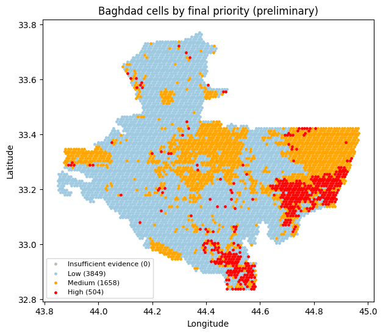
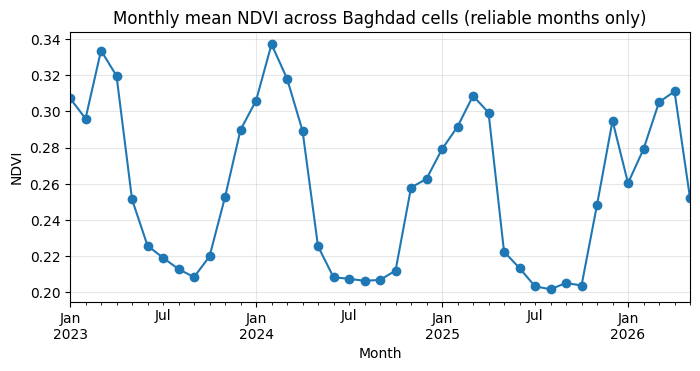
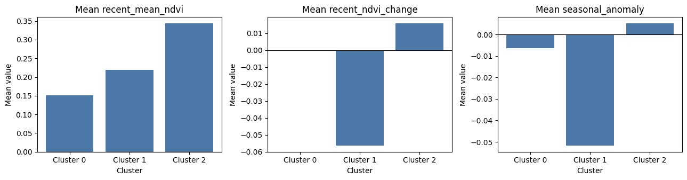

# 🌳 B.GreenSite — Where Should Baghdad Plant Trees?

**🥈 2nd place — Green Code Hackathon** · Team SiTouch · Exhibited at the Arab SMEs Summit

An ML-assisted screening tool that analyses satellite, climate and soil data for every square kilometre of Baghdad and ranks where greening and restoration work should be investigated first — shown on an interactive 3D web map.

🔗 **Live demo:** [greensite-mauve.vercel.app](https://greensite-mauve.vercel.app/#map)



| Seasonal NDVI cycle | K-Means vegetation groups |
|---|---|
|  |  |

## Overview

Baghdad has limited green cover, strong summer heat, and land that changes quickly between farming, construction and bare ground. Planting campaigns usually have a limited budget, so the first practical question is where to look first. Answering that by field visits alone is slow.

We used monthly satellite vegetation data for about 6,000 one-kilometre cells around Baghdad, covering January 2023 to May 2026. For every cell we measured how green it is, whether it lost greenness compared with the previous year, and whether it is below its usual level for the same months. We added soil and land-cover information, grouped cells with K-Means, screened them with simple rules, and ranked them. The results are shown on an interactive map and on a public website.

The MVP shows that this screening can be done with open data, a short and transparent pipeline, and a website that non-technical users can explore.

## Project Objective

B.GreenSite is an ML-assisted decision-support tool designed to support the preliminary identification and prioritization of areas in Baghdad that may benefit from reforestation or ecological restoration, particularly areas with low vegetation cover or concerning vegetation trends.

The system combines satellite-derived vegetation indicators, unsupervised clustering, transparent screening rules, and limited soil indicators to highlight potential intervention areas for further assessment.

The resulting categories and rankings are preliminary. They do not confirm that a site is suitable for planting, prove environmental degradation, or predict planting success. Data limitations, incomplete soil information, coarse climate resolution, land-use uncertainty, and the absence of verified planting-outcome labels mean that final site selection requires additional spatial validation and field or expert assessment.

The project's purpose is to help decision-makers identify where to investigate first, not to make the final planting decision.

## Problem Statement

Choosing greening sites needs several kinds of information at once: how much vegetation an area has now, how it is changing, what the soil looks like, and what the land is used for. These come from different sources at different resolutions, and vegetation in Baghdad follows a strong seasonal cycle, so a single summer image can make healthy farmland look degraded. There are also no public records of where planting succeeded or failed, which rules out training a supervised model. We needed a method that works without labels, handles seasonality, and explains every result in terms a non-specialist can check.

## Our Approach

We treat the problem as screening, not prediction. The vegetation history of each cell is reduced to three indicators: its recent 12-month mean NDVI, the change from the previous 12 months, and its difference from its own usual level in the same calendar months. Comparing full 12-month windows removes the summer and winter swing.

K-Means groups cells with similar vegetation behaviour, which helps us understand the patterns in the city. The priority itself comes from transparent rules, kept separate from K-Means on purpose, so that every rank can be traced back to specific values. Soil indicators only break ties inside a priority level. The results are shown on a Bokeh map in the notebook and on the website.

## Methodology

```
Raw CSV (one row per cell per month)
  -> Validation and preprocessing (NDVI scaling, quality flags)
  -> Feature engineering (12-month windows, seasonal anomaly)
  -> K-Means clustering (exploratory, 3 clusters)
  -> Rule-based screening (need signals, preliminary soil potential)
  -> Priority ranking (need first, then soil, then data confidence)
  -> Spaced Top-20 shortlist and Bokeh map
  -> Website data export and the B.GreenSite website
```

K-Means and the ranking are separate components. K-Means is not used to compute the priority; its clusters are shown next to it for context and compared with the rule flags as a consistency check. The full details are in [docs/METHODOLOGY.md](ml/docs/METHODOLOGY.md).

## Dataset

The input is one CSV file, greensite_baghdad_raw.csv, with 246,451 rows and 20 columns. Each row is one cell in one month. There are 6,011 cells, which are the 1 km MODIS pixel centres inside Baghdad Governorate. Each cell has the same 41 consecutive months (January 2023 to May 2026), so the row count is 6,011 × 41.

We collected the data with Google Earth Engine and the NASA POWER API, sampling every source at the cell centres. The sources are:

| Variables | Source |
|---|---|
| NDVI and quality flag | MODIS MOD13A3 v6.1, 1 km, monthly |
| Temperature, dewpoint, precipitation, soil moisture, evaporation | ERA5-Land, about 9 to 11 km, monthly |
| Relative humidity | NASA POWER RH2M, about 55 × 60 km, monthly |
| Soil pH, organic carbon, sand, clay (0 to 5 cm) | SoilGrids 2.0, 250 m |
| Land cover | ESA WorldCover 2021, 10 m |

The climate values are shared by many neighbouring cells, so we use them only as context. Soil values are missing for 756 cells (about 12%), mostly built-up land. These cells are kept and marked.

The original collection notes and validation output are in [ml/greensite_data_documentation.md](ml/greensite_data_documentation.md) and [ml/validation_report.txt](ml/validation_report.txt). The data dictionary and our quality checks are in [docs/DATASET.md](ml/docs/DATASET.md).

## Machine Learning

We used K-Means because we have no labels, and we wanted to see whether the cells fall into understandable vegetation behaviours. The inputs are only the three vegetation indicators, scaled with StandardScaler. Coordinates are excluded so the clusters describe behaviour, not location. We used k = 3 with a fixed random seed and did not tune k.

The three clusters were named from their measured statistics: lowest recent NDVI (2,559 cells, mostly bare and built-up), highest recent NDVI (2,764 cells), and a middle-NDVI group with a clear decline (685 cells, mean change -0.06). Three cells had missing indicators and were not clustered.

Evaluation is limited to what an unsupervised model allows. The silhouette score on a 3,000-cell sample is 0.411, which means weak to moderate structure: the groups are partly separated but overlap. This is a measure of cluster separation, not prediction accuracy. As a consistency check, 76% of the cells in the declining cluster were also flagged as declining by the rules, and 89% as below their seasonal level.

## Results

| Output | Result |
|---|---|
| Cells analysed | 6,011 |
| Reliable NDVI observations | 99.5% |
| Need screening: higher / moderate / lower | 514 / 1,648 / 3,849 cells |
| Final priority: High / Medium / Low | 504 / 1,658 / 3,849 cells |
| Preliminary soil potential: more promising / mixed / less promising / needs assessment | 1,553 / 3,327 / 205 / 926 cells |
| K-Means silhouette (k = 3, 3,000-cell sample) | 0.411 |
| Cells eligible for the shortlist (not built-up or water) | 5,002 |

All nine data-integrity checks in the notebook passed, and a full re-run of both notebooks on the raw CSV reproduced these numbers. The top 100 eligible cells are mostly cropland (63) and bare land (27). They are also geographically concentrated: one coarse climate pixel holds 34% of the top 100 but only 2% of all cells, which points to a regional pattern (for example crop cycles or land-use change) that should be checked on imagery. The Top-20 shortlist keeps sites at least 5 km apart so they are not all in the same area.

There is no real-world outcome validation, because no planting records were available.

## Website

Live demo: https://greensite-mauve.vercel.app/#map

The website opens with a 3D Earth that flies to Iraq and shows the 18 governorates with a search box. Baghdad is the only governorate with data; the others are marked as coming soon. Selecting Baghdad shows all 6,011 cells as 3D columns on satellite imagery.

Cells can be coloured by priority, K-Means cluster or preliminary soil potential, and each colour category can be shown or hidden. The map can show all cells, the top 100 or the spaced Top 20. A distance slider (0 to 50 km from the centre) recalculates the Top 20 in the browser with the same rule as the notebook. Clicking a cell opens a detail view with its priority rank and need signals, its vegetation indicators, its soil and land-cover information, its data limitations, and a link to the location in Google Maps. The layout also works on phones.

The website is a static site with no back-end. It is generated by the website notebook from the model results.

## Repository Structure

```
.
├── index.html, assets/, data/        the live website (deployed on Vercel), see WEBSITE.md
└── ml/
    ├── B.GreenSite_EDA.ipynb               exploratory data analysis
    ├── B.GreenSite_MVP_Model_and_Map.ipynb data processing, K-Means, screening, ranking, Bokeh map
    ├── B.GreenSite_MVP_Website.ipynb       builds the website data from the model results
    ├── greensite_baghdad_raw.zip           raw dataset (246,451 rows)
    ├── baghdad_top_candidates.csv          ranked top candidates
    ├── greensite_data_documentation.md     how the dataset was collected
    ├── validation_report.txt               output of the data collection checks
    ├── requirements.txt
    └── docs/  METHODOLOGY · DATASET · ARCHITECTURE · LIMITATIONS
```

## Getting Started

Both notebooks are written for Google Colab, which already has every package in requirements.txt. The model notebook uses Colab's upload dialog for the CSV, so running it elsewhere needs a small change to the loading cell.

To run the analysis only, open ml/B.GreenSite_MVP_Model_and_Map.ipynb in Colab and choose Runtime > Run all. When section 2 asks for a file, upload the raw CSV. The notebook writes the screening tables, the Top-100 and Top-20 files, a metadata JSON and the Bokeh map HTML to the Colab Files panel.

To build and run the website, open ml/B.GreenSite_MVP_Website.ipynb in Colab, upload B.GreenSite_MVP_Model_and_Map.ipynb to the Files panel under that exact name, and choose Runtime > Run all. The website notebook runs the model notebook first, so the CSV upload prompt appears there as well. It then builds a greensite/ folder and starts a local web server. The printed link opens the site in your own Colab session while the runtime is active; it is not a public link. This notebook needs internet access to download the map libraries, the governorate borders and the Earth textures.

## Technologies Used

The dataset was collected with Google Earth Engine and the NASA POWER API. The analysis uses Python, pandas, NumPy, scikit-learn (KMeans, StandardScaler, silhouette_score), Matplotlib, Bokeh, Shapely and Pillow, run in Google Colab. The website uses HTML, CSS and JavaScript with MapLibre GL JS 5.22.0 for the map and Three.js 0.170.0 for the Earth intro and the cell cube. Map imagery comes from Esri World Imagery, governorate borders from Natural Earth, and the Earth textures from NASA Blue Marble and Black Marble.

## Limitations

The results are preliminary screening categories. There are no planting-outcome labels, so nothing here predicts planting success. Low NDVI does not prove degradation, and year-to-year change also reflects weather and crop cycles; rainfall in the recent year was about 257 mm against 120 mm in the year before. Soil and land cover are single values at the cell centre, climate data is coarse, and the thresholds are our own MVP assumptions. See [docs/LIMITATIONS.md](ml/docs/LIMITATIONS.md).

## Future Improvements

These are future work, not part of the current MVP. We would like to check the top candidates on high-resolution imagery and in the field, use finer imagery such as 10 m Sentinel-2 to locate open space inside each cell, and add data on water access, salinity, land ownership and land use. Recording the outcome of real planting projects would make it possible to build and validate a supervised model later. Testing different values of k and the sensitivity of the thresholds is also on the list. Other governorates can be added by running the same notebooks on their data.

## Team and Acknowledgments

B.GreenSite was developed by Team SiTouch for the Green Code Hackathon.

The dataset uses MODIS MOD13A3 (NASA / USGS LP DAAC), ERA5-Land (contains modified Copernicus Climate Change Service information), NASA POWER (NASA Langley Research Center), SoilGrids 2.0 (ISRIC, CC BY 4.0), ESA WorldCover 2021 (CC BY 4.0) and the FAO GAUL 2015 boundary. The website uses governorate borders from Natural Earth, NASA Blue Marble and Black Marble imagery, and Esri World Imagery tiles. We thank the providers of these data and the maintainers of the open-source libraries listed above.
