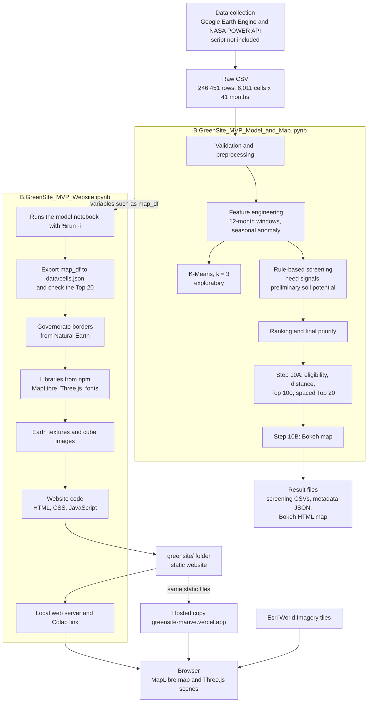

# Architecture

B.GreenSite has two notebooks and one static website. The raw CSV was collected before them with a Google Earth Engine script and the NASA POWER API; that script is not in this repository, and its notes are in greensite_data_documentation.md. The model notebook does all the analysis. The website notebook runs the model notebook, converts its results into files the browser can read, and serves the website. There is no back-end server, database or API: the website is a folder of static files.

## 1. Model notebook

B.GreenSite_MVP_Model_and_Map.ipynb takes the raw CSV and produces the analysis in memory (the `cell_features` and `map_df` tables) and as files in the Colab working directory:

| File | Content |
|---|---|
| `baghdad_cell_screening.csv` | every cell, sorted by rank |
| `baghdad_top_candidates.csv` | top 100 High or Medium candidates |
| `baghdad_screening_summary.csv` | cell counts per category |
| `baghdad_scoring_metadata.json` | definitions, thresholds and limitations |
| `greensite_baghdad_screening_map_data.csv` | map data for every cell |
| `greensite_baghdad_spatial_shortlist.csv` | spaced Top 20 (default distance) |
| `greensite_baghdad_shortlists_by_distance.csv` | spaced Top 20 for 0, 20, 30 and 40 km |
| `greensite_baghdad_top100.csv` | top 100 eligible cells |
| `greensite_baghdad_bokeh_dashboard_fixed.html` | standalone interactive Bokeh map |

These files are generated outputs and are not stored in the repository.

## 2. Website notebook

B.GreenSite_MVP_Website.ipynb starts by running the model notebook with `%run -i`, so the model's variables (`map_df`, `shortlists_by_min_distance` and the Top-20 settings) become available in the same session. It then builds the website in a `greensite/` folder:

| Step | Output | Origin |
|---|---|---|
| 11.2 | `data/cells.json` | `map_df`, re-encoded as one list per field with short codes |
| 11.3 | `data/iraq.geojson`, `data/iraq-outline.geojson` | Natural Earth admin-1 boundaries, simplified |
| 11.4 | `assets/vendor/` | MapLibre GL JS 5.22.0, Three.js 0.170.0 and two Arabic font families, downloaded from the npm registry and checked by MD5 |
| 11.5 | `assets/earth/` | NASA Blue Marble and Black Marble textures (three-globe examples) and a cloud texture (turban/webgl-earth) |
| 11.6 | `assets/cube/`, `assets/cube.webp` | the team's cube render, stored in the notebook as base64 |
| 11.7 | `index.html`, `assets/style.css`, `assets/app.js`, `assets/scene3d.js`, `assets/favicon.svg` | website source, written with `%%writefile` |
| 11.8 | running site | Python's built-in HTTP server in a background thread |
| 11.9 | `greensite-site.zip` | optional archive of the folder |

In Colab, step 11.8 turns the server port into an https link through Colab's port proxy. That link only works for the signed-in Colab user while the runtime is active. On a local Jupyter installation the site is served at `http://localhost:8000/`.

A local server is needed because browsers do not allow a page opened directly from disk to load its JSON data files.

## 3. Website

The website is plain HTML, CSS and JavaScript without a build step.

`index.html` contains the page structure: the map container, the side panel (governorate list and Baghdad filters), the cell detail view and the intro screen.

`assets/app.js` holds the map logic. It loads `cells.json` and the two GeoJSON files, then computes each cell's distance from the centre, which is the median of all cell coordinates, as the notebook does. It draws the governorate layer and the 3D cell columns with MapLibre GL JS and handles the filters: colour mode, colour categories, all cells or Top 100 or Top 20, and the distance slider. It recomputes the spaced Top 20 in the browser and fills the detail cards. Satellite imagery comes from Esri World Imagery tiles, the only external resource the site loads at run time.

`assets/scene3d.js` is an ES module built on Three.js and WebGL. It renders the Earth intro (day and night textures, clouds, atmosphere) and the rotating glass cube in the detail view, with plant cards that move in the wind. If Three.js cannot start, the site skips the Earth intro and shows the cube as a flat image. The map itself needs WebGL in every case.

`assets/style.css` holds the layout and visual style, including the phone layout with a bottom sheet in three heights.

## 4. Relationship to the hosted site

The live demo at https://greensite-mauve.vercel.app/#map serves a copy of the same static website. This repository does not include deployment configuration.

When the website notebook is run on the same model results, it reproduces `cells.json` and the website code byte for byte. The governorate borders and the Earth textures are regenerated from their original sources each time, so they can differ slightly from the hosted copies, for example in simplified border points or JPEG compression, without visible difference on the map.

## 5. External resources

| Resource | Used when | Purpose |
|---|---|---|
| npm registry | building the site | MapLibre, Three.js, fonts, three-globe textures |
| raw.githubusercontent.com (Natural Earth, turban/webgl-earth) | building the site | governorate borders, cloud texture |
| Esri World Imagery | viewing the site | satellite basemap |
| OpenStreetMap and Esri tiles | viewing the Bokeh map | basemaps in the notebook map |
| Google Maps | viewing the site (optional link) | opening a cell location |
